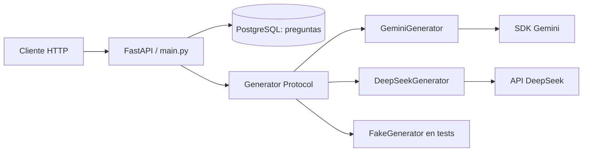

# Arquitectura actual

Mapa de responsabilidades y límites del árbol local; no una lista de tecnologías
futuras. El [estado](CURRENT_STATE.md) distingue implementación local de entrega.

## Flujo HTTP y generación

- [main.py](../src/evidenceops/main.py) define rutas, composición, dependencias
  y traducción de errores a HTTP. [schemas.py](../src/evidenceops/schemas.py)
  define contratos HTTP; OpenAPI de la API es la referencia interactiva.
- [models.py](../src/evidenceops/models.py) y
  [database.py](../src/evidenceops/database.py) separan persistencia de schemas:
  una Session por operación de datos, commit explícito y rollback ante errores.
  Migraciones en [migrations](../migrations). Motivos: [D008](decisions/D008-persistence.md).
- Al generar, se recupera el texto y se cierra la Session antes de esperar al
  proveedor. No se retiene conexión/transacción durante la inferencia. La salida
  es efímera y `external_sources_consulted` lo establece EvidenceOps.
  Motivos: [D010](decisions/D010-ephemeral-generation.md).
- [generation.py](../src/evidenceops/generation.py) es la frontera independiente
  de HTTP, DB y SDK: Protocol, contenido validado y error con causa propia.
  [generator_factory.py](../src/evidenceops/generator_factory.py) elige el adapter
  mediante configuración. [gemini.py](../src/evidenceops/gemini.py) y
  [deepseek.py](../src/evidenceops/deepseek.py) aplican instrucciones compartidas,
  validan la salida y clasifican fallos propios. [D012](decisions/D012-generator-boundary.md).

## Configuración y recursos

[config.py](../src/evidenceops/config.py) valida configuración del entorno y
`.env`. `GenerationSettings` no exige DB; `Settings` añade su URL para la API.
Las variables de entorno prevalecen sobre `.env`; defaults y nombres en
[.env.example](../.env.example), dependencias en [pyproject.toml](../pyproject.toml)
y versiones resueltas en [uv.lock](../uv.lock).

`EVIDENCEOPS_LLM_PROVIDER` selecciona `gemini` (por defecto) o `deepseek`; cada
uno usa su clave, modelo, límite de salida y timeout. La configuración Gemini
existente conserva sus nombres y valores por defecto.

El lifespan comprueba PostgreSQL al arrancar y crea/reutiliza un generador si
no se inyecta uno. Falta de clave impide ese arranque, pero no se hace inferencia
ni se verifica la clave contra el proveedor. La aplicación cierra solo recursos
propios y libera el Engine incluso si falla el cierre del generador.
[Startup](decisions/D009-startup.md) y [ownership](decisions/D012-generator-boundary.md).

## Subsistemas independientes

La adquisición PubMed se mantiene fuera de FastAPI, DB y generación:
[pubmed.py](../src/evidenceops/pubmed.py) hace ESearch/EFetch y clasifica errores
externos; [pubmed_parser.py](../src/evidenceops/pubmed_parser.py) interpreta XML
y separa registros inválidos; [biomedical.py](../src/evidenceops/biomedical.py)
define el contrato interno sin tipos de PubMed. `PubMedSettings` tiene entorno
independiente. [publications.py](../src/evidenceops/publications.py) hace el
upsert atómico en PostgreSQL dentro de la transacción del llamador; el modelo y
la migración protegen `(source, source_id)` y conservan un UUID interno. El
cliente PubMed no persiste ni alimenta la generación.
[ingestion_cli.py](../src/evidenceops/ingestion_cli.py) implementa `evidenceops ingest`
y posee/cierra cliente y Engine; [ingestion.py](../src/evidenceops/ingestion.py)
coordina búsqueda opcional, deduplicación, lotes y fallos parciales sin poseer
los recursos inyectados. Cada documento tiene su transacción y solo cuenta éxito
tras el commit. El UUID candidato frente al devuelto distingue crear/actualizar
sin leer antes de escribir. Flujo:

`CLI → ESearch opcional → PMIDs únicos → EFetch por lote → parser → BiomedicalDocument → upsert → commit → resumen`

No se retiene conexión DB durante adquisición. No hay endpoint de ingestión;
el servicio RAG puede recuperar sus representaciones indexadas para generación. Motivos y alcance en
[D021](decisions/D021-biomedical-ingestion-source-and-contract.md) y
[D022](decisions/D022-biomedical-publication-persistence.md) y
[D023](decisions/D023-biomedical-ingestion-pipeline.md).

La representación de publicaciones en [chunking.py](../src/evidenceops/chunking.py)
es una transformación pura: `build_retrievable_unit(document, publication_id=...)`
recibe `BiomedicalDocument` y el UUID de origen; devuelve una `RetrievableUnit`
inmutable o `None` si no hay contenido. Una fila persistida puede convertirse con
`as_biomedical_document` sin añadir acceso a DB a la transformación. Conserva
título, abstract y procedencia. Une solo campos con contenido: título y abstract
con `"\n\n"` entre ambos, solo título o solo abstract si falta el otro; si ninguno
tiene contenido devuelve `None`. No normaliza Unicode, divide,
trunca ni impone tamaño mínimo. La identidad depende de `(source, source_id)`,
estrategia versionada e índice cero; el fingerprint depende del texto efectivo.
El UUID interno sirve de vínculo con la fila y no participa en esos hashes.
Se reutiliza en indexación y retrieval de #39; ingestión y generación siguen
independientes.
[Decisión y detalles de reproducibilidad](decisions/D024-retrieval-baseline-and-embeddings.md).

La [evaluación](../evaluation/README.md) usa Generator sin FastAPI ni PostgreSQL:
dataset → run → revisión humana → comparación. Dataset, outputs y juicios son
artefactos diferentes. Estructura válida no implica contenido correcto.

La [observabilidad](subsystems/observability.md) registra eventos comunes de
generación, expone métricas Prometheus en `/metrics` y traza con OpenTelemetry
HTTP → generación → adapter del proveedor; los adapters aportan el usage real
sin cambiar contratos de negocio.
Sus límites y diagnóstico se conservan en el [subsistema](subsystems/observability.md)
y el [plan M5 completado](plans/completed/m5-observability.md).

No hay capa Repository, framework de agentes ni orquestación anticipada.
Consulta el [índice ADR](decisions/README.md) antes de cambiar estos límites.

## Indexación y búsqueda vectorial local

`Publication → chunking → LocalMedCPT Article Encoder → UnitEmbedding → pgvector`.
[embeddings.py](../src/evidenceops/embeddings.py) define una frontera pequeña
para MedCPT con dos métodos y configuración explícita, sustituible por dobles.
Carga PyTorch/Transformers y pesos de forma diferida; revisiones fijadas, CPU,
CLS y entrada título/abstract como par. El tokenizer trunca la entrada del
encoder a 512 tokens de artículo o 64 de query; la unidad conserva todo el texto. No hay
factoría multiproveedor.

[retrieval.py](../src/evidenceops/retrieval.py) posee las transacciones de
indexación: lee snapshot, cierra sesión, codifica, bloquea publicación y valida
que el snapshot siga vigente antes de sustituir el vector. Una fila por unidad
y publicación; FK con cascade. Fingerprint y configuración determinan reuse
o reindexación; un cambio incompatible requiere autorización explícita mediante
`replace_incompatible=True`. No conserva histórico de vectores.

`query → Query Encoder → filtro SQL por año → dot product → top_k`.
La búsqueda exacta de pgvector usa `<#>` (producto interno negativo), orden
ascendente y score con signo invertido; desempate por identidad de unidad.
Rechaza configuraciones incompatibles y excluye snapshots obsoletos antes del
LIMIT. Une metadata vigente y devuelve unidad trazable más score. Sin HTTP ni GraphQL; el servicio RAG reutiliza esta búsqueda sin modificarla.

[retrieval_demo.py](../src/evidenceops/retrieval_demo.py) compone recursos para
una prueba manual sobre publicaciones ya ingeridas. Contratos, límites y comandos
en el [README](../README.md#embeddings-y-retrieval-local-m7--39); motivos en D024.

La evaluación de retrieval en [retrieval_evaluation.py](../src/evidenceops/retrieval_evaluation.py)
valida snapshots congelados y usa el indexador/buscador existente en un esquema
PostgreSQL aislado. Separa corpus, juicios binarios previos y resultados por query;
el top-5 operacional y el ranking completo alimentan métricas deterministas.
Solo el comando explícito `--live` ejecuta MedCPT; los tests usan dobles.
[Procedimiento y límites](../evaluation/retrieval/README.md).

M9.1 añade BM25 en memoria sobre las mismas unidades indexadas vigentes y
filtros; fusiona candidatos con MedCPT mediante RRF (k=60), deduplicando por
unit_id. El modo semántico sigue siendo el predeterminado. La selección RAG
se configura al arrancar mediante `EVIDENCEOPS_RETRIEVAL_MODE`. No cambia
generación ni prompts. [Decisión y escalabilidad](decisions/D030-hybrid-retrieval.md).

M9.2 incorpora el modo `reranking` sobre los primeros 20 candidatos semánticos:
Cross-Encoder MedCPT local con revisión fija, pares consulta/texto y límite de 512
tokens, logits descendentes y desempates por unidad. RAG consume top5 sin cambiar
prompts/generación; el adaptador se carga al primer uso y mantiene las dependencias
opcionales. Errores se propagan por la política RAG existente. La evaluación
preserva los 20 candidatos y la cola semántica para MRR completo, además de calidad
y tiempos por etapa/consulta. [Experimento real y límites](../evaluation/retrieval/REPORT-m9.2.md).
[Decisión, protocolo y límites](decisions/D031-medcpt-reranking.md).

## Servicio RAG v1 de M8

[rag.py](../src/evidenceops/rag.py) implementa el contrato de
[D026](decisions/D026-rag-v1-contract-context-and-citations.md):
`query → retrieval seleccionado → contexto → Generator → validación → answer + limitations + sources`.
`RagService` recibe un callable de búsqueda (M7 con sesiones y encoder ligados)
y el `Generator` existente. Solicita top-5 con año inicial opcional. No posee
recursos, accede a HTTP ni persiste respuestas.

`build_context` conserva recuperados, incluidos y omitidos en orden; asigna S1…Sn
al incluir unidades completas. El presupuesto de 20.000 caracteres cuenta la
lista de evidencia serializada como JSON compacto con Unicode literal, incluida
metadata y escapes. Omite una unidad que no cabe y continúa con las siguientes.
El mensaje contiene query y evidence como datos; las instrucciones RAG separadas
se pasan mediante `generate(..., system_instruction=...)`. Con `None`, Gemini y
DeepSeek conservan las instrucciones originales, formato, límites y timeout.

La aplicación construye `sources` con unidad íntegra y score de cada fuente
incluida, también las no citadas. Valida pertenencia y formato de las citas en
answer y limitations, y exige citas al final de cada párrafo o elemento de lista.
Fallos producen `GenerationError(INVALID_OUTPUT)` sin reparación ni retry RAG.
La única abstención del modelo sin citas es la frase fija con limitations vacío;
la aplicación añade la limitación operacional. Sin resultados o si no cabe ninguna
fuente, se abstiene sin invocar al generador. Los fallos técnicos se propagan.

La validación es estructural: no demuestra apoyo semántico ni groundedness.
La API compone el servicio en lifespan con `partial(search, sessions, encoder)`
y el generador compartido de la factoría. `POST /rag` recibe query/año sin
persistencia previa y serializa las fuentes completas. `LocalMedCPT` conserva
carga diferida; se puede inyectar un encoder para integración determinista.
Los errores de retrieval se traducen a causas seguras; un subtipo de
`GenerationError(INVALID_OUTPUT)` distingue citas inválidas de errores de esquema
del proveedor. La ruta reutiliza las traducciones HTTP de generación existentes.
[D027](decisions/D027-rag-http-errors-and-observability.md) documenta composición,
errores y límites. El servicio observa operación, retrieval, contexto y generación
con logs, métricas y spans M5, sin registrar contenido.

La [evaluación RAG](../evaluation/rag/README.md) (#47) ejecuta el servicio en un
esquema PostgreSQL aislado sobre el corpus congelado M7. Un observador opcional
recibe el contexto real; un wrapper del generador conserva su output tipado para
revisar rechazos de citas sin repetir llamadas. Las trazas públicas se guardan en
artefactos locales, sin secretos ni cuerpos de error arbitrarios. Reutiliza la
revisión humana M4 con dimensiones RAG y N/A justificado; exige runs completos,
trazas verificadas y revisión completa para promocionar. Casos previos aprobados;
corrida real completa y baseline v1 con revisión humana asistida aprobado y
promocionado; [resultados y límites](../evaluation/rag/REPORT-v1.md). Decisión en [D028](decisions/D028-rag-evaluation.md).
Composición y pruebas deterministas en el [README](../README.md#rag-v1-m8--45).
