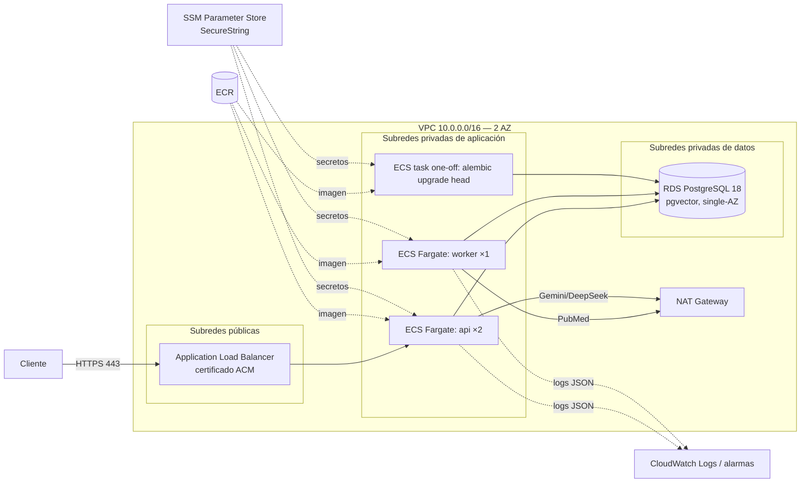

# Arquitectura objetivo en AWS (M12.2, solo diseño)

Diseño **no provisionado**. No se ha creado ningún recurso, ni se han usado
credenciales, ni se ha ejecutado ningún comando contra AWS. El motivo y las
alternativas están en [D039](../decisions/D039-aws-design-without-provisioning.md).
El punto de partida es el despliegue Kubernetes local de M12.1
([D038](../decisions/D038-local-kubernetes.md)): la misma imagen, las mismas
variables y la misma semántica de probes.

## Vista general

## Componentes

| Necesidad | Servicio | Equivalente M12.1 | Motivo |
| --- | --- | --- | --- |
| Imagen | **ECR** privado, escaneo al subir, lifecycle de 10 imágenes | `kind load` | Registro en la misma región; sin tráfico de salida |
| Compute | **ECS on Fargate**: servicio `api` (2 tareas de 0,25 vCPU / 0,5 GB), servicio `worker` (1 tarea) y task definition `migrate` lanzada antes de cada despliegue | Deployments + Job | Sin nodos que parchear ni plano de control de pago. La imagen y los comandos son los de M12.1 |
| Entrada | **ALB** con listener 443 (ACM) y 80→301 | Traefik | TLS gestionado y health checks por target |
| Base de datos | **RDS for PostgreSQL** `db.t4g.micro`, 20 GB gp3, single-AZ, backups de 7 días, cifrado en reposo | StatefulSet | pgvector es una extensión soportada. Multi-AZ duplicaría el coste sin requisito de HA |
| Secretos | **SSM Parameter Store** (SecureString con clave gestionada por AWS) inyectados como `secrets` de la task definition | Secrets de `secrets.sh` | Parámetros estándar sin coste. Secrets Manager añade rotación (~0,40 USD/secreto/mes), que aquí no se necesita |
| Configuración | `environment` de la task definition | ConfigMap | Mismas variables `EVIDENCEOPS_*` |
| Observabilidad | **CloudWatch Logs** (driver `awslogs`, retención de 14 días) y alarmas sobre métricas nativas | `kubectl logs` | Los logs ya son JSON (D016). Métricas Prometheus y trazas OTel quedan opcionales vía ADOT sidecar → CloudWatch/X-Ray |

### Red

- VPC con dos AZ, subredes públicas (solo ALB y NAT), privadas de aplicación y
  privadas de datos sin ruta a Internet.
- Security groups encadenados: `alb-sg` admite 443/80 desde Internet; `app-sg`
  admite 8000 solo desde `alb-sg` (el worker no admite entrada); `db-sg` admite
  5432 solo desde `app-sg`.
- Salida a Internet (PubMed, proveedores LLM) mediante un NAT Gateway en una AZ.
  Para leer ECR, SSM y CloudWatch Logs sin pasar por el NAT se pueden usar VPC
  endpoints, aunque cada endpoint de interfaz tiene coste horario. La variante
  barata elimina el NAT y pone las tareas en subredes públicas con IP pública y
  sin entrada salvo desde el ALB (ver costes).

### IAM de mínimo privilegio

| Rol | Lo asume | Permisos |
| --- | --- | --- |
| `evidenceops-task-execution` | Agente de ECS | `ecr:GetAuthorizationToken`; `ecr:BatchGetImage` y `ecr:GetDownloadUrlForLayer` sobre el ARN del repositorio; `logs:CreateLogStream` y `logs:PutLogEvents` sobre los log groups `/evidenceops/*`; `ssm:GetParameters` sobre `arn:…:parameter/evidenceops/*`; `kms:Decrypt` condicionado a `kms:ViaService = ssm.<región>.amazonaws.com` |
| `evidenceops-api-task` / `evidenceops-worker-task` | Código de la aplicación | **Ninguno**: la app no llama a APIs de AWS. Roles separados para poder añadir permisos sin compartirlos |
| `evidenceops-deploy` | GitHub Actions vía **OIDC** (sin claves de larga duración), condicionado a `repo:<owner>/biomedical-evidenceops:ref:refs/heads/main` | Push a ese repositorio ECR; `ecs:RegisterTaskDefinition`, `ecs:UpdateService` y `ecs:RunTask` sobre el clúster; `iam:PassRole` solo sobre los tres roles anteriores |
| Humanos | IAM Identity Center | Acceso de lectura y retirada; nada de usuarios IAM con access keys |

La cuenta conserva MFA en root, sin access keys en root, CloudTrail de gestión y
un AWS Budget con alertas. La alerta avisa, pero no detiene el gasto.

### Health checks: una diferencia importante con Kubernetes

ECS reemplaza las tareas que el ALB marca como no sanas, y no tiene un concepto de
readiness distinto de liveness. Si el health check del target group apuntara a
`/ready`, una caída de RDS haría que ECS matara y recreara todas las tareas de la
API: la tormenta de reinicios que D037 evita. Por eso el diseño usa:

- Health check del ALB y del contenedor sobre **`/health`** (liveness).
- Durante una caída de RDS, las tareas siguen en servicio y responden 503
  `database_unavailable` (D037). `/ready` queda para diagnóstico y para una
  alarma de CloudWatch (synthetic canary opcional, de pago).
- El orden de despliegue lo garantiza el pipeline: `RunTask migrate` termina
  antes de `UpdateService`. La readiness ya no puede retener el tráfico.

### Otras diferencias con M12.1

- **Límite de cuerpo:** el ALB no tiene un límite configurable. Las opciones son
  AWS WAF (de pago, con regla de tamaño de cuerpo), un límite en la aplicación o
  aceptar el riesgo. El diseño propone el límite en la aplicación como trabajo
  futuro. No se implementa porque M12 no lo pide.
- **Rate limit:** sigue siendo en memoria por tarea (N× con N tareas). Una regla
  rate-based de WAF lo haría global por IP, no por API key.
- **Worker:** el lease sin heartbeat (D036) no cambia. Con 1 tarea y
  `stopTimeout` de 60 s se conserva la parada ordenada.

## Estimación de costes (orientativa)

Precios de lista on-demand aproximados en `eu-west-1`, sin free tier. Se
**verificarían con AWS Pricing Calculator antes de cualquier despliegue**, porque
pueden haber cambiado. Mes = 730 h.

| Partida | Supuesto | USD/mes aprox. |
| --- | --- | --- |
| Fargate API | 2 × (0,25 vCPU + 0,5 GB) x86 | 18 |
| Fargate worker | 1 × (0,25 vCPU + 0,5 GB) | 9 |
| ALB | horas + LCU mínimas | 20–25 |
| RDS | `db.t4g.micro` single-AZ + 20 GB gp3 + backups dentro del tamaño | 15–17 |
| NAT Gateway | 1 AZ, horas + pocos GB procesados | 35–40 |
| IPv4 públicas | ALB en 2 AZ + NAT (≈0,005 USD/h cada una) | 11 |
| CloudWatch Logs | < 1 GB/mes ingerido, 14 días | 1–2 |
| ECR, SSM estándar, KMS gestionada, ACM | — | < 1 |
| **Total con NAT** | | **≈ 110–125** |
| **Variante sin NAT** (tareas en subred pública con IPv4 pública, ARM/Graviton) | −NAT, +3 IPv4, −20 % Fargate | **≈ 75–85** |

Un mes de práctica dejada encendida cuesta más que todo el resto del proyecto,
cuyo coste en infraestructura es cero. Sin el ALB (IP pública directa a una tarea)
bajaría a unos 45–50 USD, pero se pierden TLS gestionado y health checks.
Extensiones con coste adicional: Multi-AZ (×2 en RDS), WAF, ADOT/Managed
Prometheus, VPC endpoints y el extra `medcpt` (tareas de ≥2 GB de memoria).

## Por qué no se provisiona

1. **El roadmap exige coste cero garantizado**, no estimado. Ninguna partida
   esencial (ALB, RDS, NAT, IPv4 pública, Fargate) es gratuita de forma
   permanente.
2. **Los créditos y el free tier son temporales.** El roadmap prohíbe depender de
   ellos, y la facturación tras agotarlos o por un recurso olvidado es real.
3. **Una alerta de presupuesto no detiene el gasto.** Llega con retraso, y las
   acciones de Budgets no paran todos los servicios.
4. **El encargo de M12.2 lo prohíbe expresamente.** Lo transferible (red, IAM,
   health checks, secretos y costes) se aprende con el diseño. La mecánica de
   orquestación ya se practicó en M12.1.

## Procedimiento de retirada (si alguna vez se desplegara)

Requisito previo: todo lo crearía IaC (CloudFormation o Terraform) con la
etiqueta `project=evidenceops`, de modo que la retirada sea un `destroy` y una
comprobación. Si hubiera que hacerla a mano, este es el orden:

1. ECS: escalar `api` y `worker` a 0, borrar los servicios, las task definitions
   (deregister) y el clúster.
2. ALB: borrar listeners, el balanceador y los target groups. Borrar el
   certificado ACM si no se usa.
3. RDS: desactivar la protección de borrado y borrar sin snapshot final (los datos
   son públicos y se pueden reingerir). Borrar los snapshots manuales y
   automáticos que queden.
4. Red: borrar el NAT Gateway, liberar las Elastic IPs, borrar los VPC endpoints,
   los security groups, las subredes, el Internet Gateway y la VPC.
5. ECR: borrar el repositorio con sus imágenes. SSM: borrar
   `/evidenceops/*`. CloudWatch: borrar los log groups y las alarmas.
6. IAM: borrar los roles, sus políticas y el proveedor OIDC de GitHub si no se
   reutiliza.
7. Verificación: Tag Editor / Resource Explorer sin recursos `project=evidenceops`
   en ninguna región. Al día siguiente, Cost Explorer debe mostrar 0 USD
   imputados por servicio. Mantener el Budget con alerta a 1 USD durante el
   siguiente ciclo de facturación.
