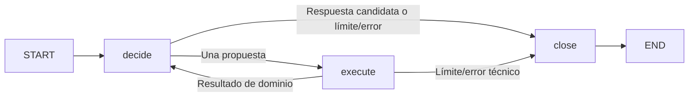

# Agente de evidencia — M10.2 (#57)

Decisión y alternativas: [D033](../decisions/D033-bounded-langgraph-agent.md).
Implementación: [agent.py](../../src/evidenceops/agent.py). Servicio independiente,
sin endpoint nuevo, persistencia, MCP ni cambios en RAG y sus baselines.

## Composición y responsabilidades

`AgentService(model, executor).run(question)` recibe el mismo `ToolExecutor`
de [M10.1](tools.md). Para corpus real, `create_tool_executor(sessions, encoder)`
reutiliza búsqueda semántica y lectura por UUID; las conexiones se liberan antes
del LLM. `create_deepseek_tool_caller(settings, metrics)` también implementa el
turno `decide(messages, tools, timeout_seconds=...)`. El llamador posee/cierra
adapter y Engine; el agente no cierra recursos inyectados. Componer estos recursos
no ejecuta una inferencia; cualquier ejecución real necesita autorización específica.

LangGraph coordina tres funciones, sin agente preconstruido:



- `decide`: el modelo elige una llamada o una respuesta, con el historial de
  resultados disponible. No ejecuta herramientas ni establece sus presupuestos.
- `execute`: la aplicación valida argumentos, repetición, ID y presupuesto;
  ejecuta una herramienta, registra fuentes y añade el intercambio correlacionado.
- `close`: valida citas/abstención o conserva el fallo terminal. No llama al LLM.

Estado: un historial (incluye pregunta y resultados), registro de fuentes por
UUID, decisión pendiente, firmas de llamadas, contadores, inicio, operation_id
y estado/motivo terminal. Sin lista duplicada de resultados ni memoria entre runs.
El grafo se compila sin checkpointer/store/retries/cache. No requiere LangSmith
ni otro servicio externo; se utiliza la observabilidad M5.

## Recorrido representativo

1. `decide` propone `search_evidence`: descubre candidatos, sin abstracts.
2. `execute` usa el ejecutor de M10.1, asigna etiquetas globales e incorpora el
   resultado con su `tool_call_id` original.
3. `decide` elige `get_publication` con un UUID descubierto.
4. `execute` lee bibliografía y abstract; conserva la etiqueta de esa publicación,
   aunque el ejecutor independiente devolviese S1. Leer la segunda candidata
   conserva S2. Actualiza el registro sin degradar abstracts a metadata después.
5. `decide` propone `GeneratedContent` con citas o la abstención fija.
6. `close` valida y devuelve contenido/fuentes desde los contratos de la aplicación.

El resultado de búsqueda y el abstract se envían como mensajes `tool`, no como
instrucciones del sistema. El prompt delimita también la pregunta como datos no
confiables. El score de búsqueda no representa confianza clínica.

## Resultado y fuentes

`AgentResponse` contiene `status`, `termination_reason`, `content`, `sources`,
`operation_id`, `steps`, `llm_calls` y `tool_calls`.

| Estado | Significado | Contenido |
| --- | --- | --- |
| `answered` / `final_answer` | Respuesta que supera validación estructural | `GeneratedContent` |
| `abstained` / `insufficient_evidence` | Abstención fija validada | Frase fija y limitación operacional |
| `limit_exceeded` | Presupuesto, repetición o defensa del framework | null |
| `error` | Protocolo, modelo, herramienta o validación fallidos | null |

`sources` procede exclusivamente del registro de resultados aceptados en el
historial por la aplicación, nunca de bibliografía generada. Incluye fuentes no
citadas y puede existir en errores como contexto diagnóstico; no convierte esos
resultados en respuestas válidas. Solo en una finalización satisfactoria se sabe
que el modelo recibió todo ese historial. No se truncan abstracts ni se añaden
fuentes de un resultado rechazado por tamaño.

Identidad y etiquetas estables por UUID; una identidad externa contradictoria es
`backend_error`. La lectura completa añade autores y abstract disponible. Una
búsqueda posterior mantiene ese detalle en el registro. Las fuentes no equivalen
a evidencia suficiente: metadata solo permite describir candidatos. Las respuestas
sin abstracts llevan la limitación de metadata; con lectura, explicitan que no
se consultaron textos completos. Estas limitaciones operacionales se añaden
tras validar el contenido del modelo, siguiendo M10.1.

`validate_tool_answer` reutiliza las reglas RAG por IDs y rechaza referencias
URL/DOI/PMID libres. Sin fuentes solo se acepta `ABSTENTION_ANSWER` con limitations
vacío; después la aplicación normaliza la limitación operacional. Citas válidas
no prueban factualidad, suficiencia, apoyo semántico o inmunidad a prompt injection.

## Presupuestos y errores

- **4 solicitudes LLM**, **3 herramientas**, **8 entradas en nodos**; cada intento
  cuenta antes de la llamada externa, también si falla. Una herramienta por turno.
- Tras tres herramientas, reservar una última decisión con tools deshabilitadas.
  Responder/abstenerse válidamente es éxito/abstención; solicitar otra herramienta
  termina con `tool_call_limit`. Un fallo de esa solicitud sigue siendo error.
- **120 segundos cooperativos** medidos con reloj monótono antes/después del trabajo.
  Al detectar exceso: `time_budget`, contenido null, ninguna nueva llamada externa.
  Una respuesta válida que llega tarde se descarta; no se intenta sintetizar otra.
- Timeout HTTP por fase: mínimo entre configuración del adaptador y tiempo restante,
  sin alterar el default del cliente compartido. Conservar 5 s SQL por sentencia,
  15 s cooperativos de herramienta, 4.000 caracteres de argumentos y 20.000 por
  resultado de M10.1. Ninguno garantiza cancelación total de CPU o del run.
- Historial compacto hasta **64.000 caracteres**, incluidos instrucciones y mensajes.
  Igual al límite cabe; exceso produce `history_limit`. Sin resumen ni truncado.
- Cero retries. Firma por nombre y argumentos validados, incluidos defaults y
  normalización del contrato; repetición exacta → `repeated_call` antes del backend.
  Variaciones repetitivas terminan por los límites globales. IDs nativos duplicados
  → `invalid_call`.
- `recursion_limit=10` protege ante ciclos inesperados del grafo. En esta versión,
  ocho entradas requieren al menos 9 para completar la salida. Un valor insuficiente
  produce `recursion_limit`, conserva los contadores y descarta cualquier candidato,
  incluso si el nodo `close` ya se había ejecutado. No confundirlo con herramientas
  ni solicitudes LLM. No se aumenta automáticamente tras un fallo.

Vacío, `publication_not_found` y abstract null permiten otra decisión dentro del
presupuesto. Fallos técnicos del ejecutor, argumentos/protocolo inválidos, errores
del proveedor y citas inválidas terminan sin recuperación ni abstención artificial.
Causas de herramienta/proveedor conservan los códigos de M10.1; excepciones
inesperadas usan `unexpected_application_error`, sin publicar su texto.

## Demo y verificación offline

```bash
uv sync --locked --dev
uv run --locked python -m evidenceops.agent_demo --scenario evidence --logs
uv run --locked python -m evidenceops.agent_demo --scenario budget
uv run --locked python -m evidenceops.agent_demo --scenario exhausted
uv run --locked python -m evidenceops.agent_demo --scenario repeat
```

`evidence` recorre búsqueda → lectura → respuesta: 3 solicitudes simuladas,
2 herramientas y 6 nodos. `budget` completa una respuesta de descubrimiento en
4/3/8; `exhausted` insiste en pedir una cuarta herramienta y termina por límite,
con contenido null. Otros escenarios: `empty`, `not-found`, `no-abstract`,
`backend-error`, `model-error`, `timeout`, `invalid-citations`.

Siempre datos sintéticos, adapter real con `httpx.MockTransport`, clave ficticia,
sin DB, red ni descargas. El texto es prefijado, no evidencia clínica ni evaluación IA.

```bash
uv run --locked pytest tests/test_agent.py tests/test_tools.py tests/test_tool_calling.py tests/test_deepseek_tools.py
uv run --locked pytest tests/test_agent_integration.py tests/test_tools_integration.py tests/test_rag_integration.py
```

La segunda orden requiere PostgreSQL de pruebas según el README. Verifica servicios
reales y liberación de conexiones antes de cada decisión con encoder/LLM simulados.
Las pruebas cubren caminos máximos, `recursion_limit` bajo, tiempo tras trabajo,
finalización reservada satisfactoria/fallida, fuentes estables, ausencia de evidencia,
repetición y rechazo de citas. No se ejecutan inferencias reales ni se cambian baselines.

Logs/spans `agent.operation`, `agent.decide`, `agent.execute`, `agent.close`;
evento `agent.finished` con stage, transición, operation/call IDs, herramienta,
contadores, duración y motivo. El proveedor conserva spans/usage observado de M5.
No activar captura genérica del estado: contiene pregunta y resultados completos.

## Repaso pendiente con el desarrollador

Recorrer `evidence`, explicar por qué el modelo propone pero la aplicación ejecuta,
y comparar `budget` con `exhausted`: usar el último turno para finalizar no significa
exceder presupuesto. Revisar `repeat`, los límites cooperativos y la diferencia
entre cita existente y apoyo semántico. Sin otra inferencia real ni cuestionario
rutinario. Registrar solo comprensión observada y dudas, no atribuirla a estos tests.


## Ejecutor MCP opcional (M10.3)

`AgentService` acepta el contrato `AgentToolExecutor` (`validate`, `execute`).
Además del ejecutor directo, `connect_mcp_tools()` proporciona uno respaldado
por el SDK MCP v2 y un servidor stdio local durante todo el run. No cambia el
modelo, grafo, presupuestos, historial ni citas. [Composición, límites de transporte
y demo con DB sin LLM](mcp.md); [D034](../decisions/D034-local-mcp-integration.md).
