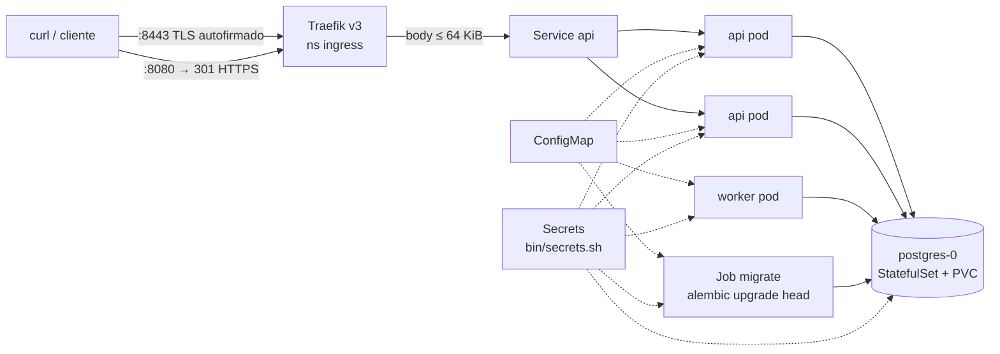

# Kubernetes local (M12.1)

Despliegue de práctica en un clúster **kind** de un nodo, sin Helm. No es un
entorno de producción ni de alta disponibilidad. Las decisiones y alternativas
están en [D038](../decisions/D038-local-kubernetes.md). Los manifiestos y scripts
viven en [deploy/k8s](../../deploy/k8s).

## Topología



| Recurso | Manifiesto | Notas |
| --- | --- | --- |
| Imagen `evidenceops:local` | [Dockerfile](../../Dockerfile) | Una imagen para API, worker y migraciones; sin el extra `medcpt` |
| PostgreSQL + pgvector | [postgres.yaml](../../deploy/k8s/postgres.yaml) | StatefulSet de 1 réplica, PVC de 2 GiB (`local-path` de kind) |
| Migraciones | [migrate-job.yaml](../../deploy/k8s/migrate-job.yaml) | Job; se borra y recrea en cada despliegue |
| API | [api.yaml](../../deploy/k8s/api.yaml) | Deployment de 2 réplicas + Service; startup/liveness `/health`, readiness `/ready` |
| Worker | [worker.yaml](../../deploy/k8s/worker.yaml) | Deployment de 1 réplica; sin probes (no expone HTTP) |
| Ingress | [ingress.yaml](../../deploy/k8s/ingress.yaml), [traefik.yaml](../../deploy/k8s/traefik.yaml) | Traefik con manifiestos planos; TLS autofirmado, redirección HTTP→HTTPS y límite de cuerpo |
| Configuración | [configmap.yaml](../../deploy/k8s/configmap.yaml) | Solo valores no sensibles; defaults de retrieval/generación intactos |
| Secretos | [bin/secrets.sh](../../deploy/k8s/bin/secrets.sh) | Generados en el clúster con `openssl rand`; nunca en el repositorio |

## Operar

Requisitos: Docker, `kind` y `kubectl` en el `PATH`. En el WSL usado para M12 la
integración de Docker Desktop no estaba activa: se usó un shim `docker` que
ejecuta `docker.exe`. kind invoca la CLI, así que basta. Los puertos publicados por
Docker Desktop (`127.0.0.1:8080/8443` y la API de Kubernetes) son accesibles
desde WSL.

```bash
deploy/k8s/bin/up.sh      # clúster, imagen, ingress, secretos, BD, migraciones, API y worker
deploy/k8s/bin/smoke.sh   # health/ready, 401 sin clave, alta+lectura con X-API-Key, 413, 301
deploy/k8s/bin/chaos.sh   # borrar un pod de la API; parar y recuperar PostgreSQL
deploy/k8s/bin/down.sh    # borrar el clúster entero, volúmenes incluidos
```

`up.sh` es idempotente: reconstruye la imagen, la carga con `kind load` y
reinicia API/worker. Conserva los secretos existentes, porque un password nuevo
no coincidiría con el volumen de PostgreSQL ya inicializado. Si
`EVIDENCEOPS_GEMINI_API_KEY` está en el entorno al crear los secretos, se usa. Si
no, se guarda un placeholder: la API arranca, pero generate/RAG fallarán. Sin el
extra `medcpt`, `/rag` tampoco puede codificar consultas. El despliegue cubre
preguntas, jobs y probes, no inferencia.

Para usar la API: `curl -k --resolve evidenceops.local:8443:127.0.0.1
https://evidenceops.local:8443/...`. La clave se obtiene con `kubectl -n
evidenceops get secret evidenceops-secrets -o jsonpath='{.data.EVIDENCEOPS_API_KEYS}' | base64 -d`.

## Conceptos aplicados

- **Liveness frente a readiness** ([D037](../decisions/D037-operational-readiness.md)):
  la liveness (`/health`) no consulta dependencias, así que una caída de
  PostgreSQL no reinicia la API. La readiness (`/ready`) da 503 y Kubernetes saca
  el pod de los endpoints del Service hasta que la BD vuelve. La startup probe
  cubre imports y la primera conexión. Si la BD no está al arrancar, el lifespan
  falla, el contenedor sale y Kubernetes reintenta con backoff.
- **Orden por readiness, no por script:** API y worker pueden arrancar antes de
  que termine el Job de migraciones. Mientras tanto, `/ready` informa
  `migrations: missing/outdated` y el pod no recibe tráfico.
- **Requests/limits:** la request reserva capacidad para el scheduler y el limit
  la acota (CPU con throttling, memoria con OOMKill). Los valores parten de la
  memoria medida con `memory.peak` del cgroup: API ≈105 MiB en reposo, worker
  ≈79 MiB y PostgreSQL ≈53 MiB. No hay metrics-server en el clúster.
- **Secretos:** un `Secret` es base64, no cifrado. Lo protege el RBAC del clúster
  y, en un clúster real, el cifrado en reposo de etcd o un gestor externo. La URL
  de la BD es secreta porque incluye el password.
- **Contenedores endurecidos:** usuario no root, sin escalada de privilegios,
  capacidades eliminadas y raíz de solo lectura (con `emptyDir` en `/tmp` para la API).

## Escalado y sus límites

`kubectl -n evidenceops scale deployment/api --replicas=N` funciona porque la
API no guarda estado de sesión, pero no todo escala igual:

| Componente | ¿Escala horizontalmente? | Límite |
| --- | --- | --- |
| API | Sí | El **rate limit es en memoria por proceso** (D037): con N réplicas el límite efectivo por clave es N × capacidad, y depende de a qué pod enrute el Service. Un límite global necesitaría estado compartido (PostgreSQL o Redis) |
| API | Sí | Cada réplica tiene su pool de conexiones: N × pool contra un único PostgreSQL. `max_connections` acota N antes que la CPU |
| Worker | Sí, con cuidado | `SKIP LOCKED` y el fencing por intento permiten varios workers (D036). El **lease no tiene heartbeat**: un job más lento que `EVIDENCEOPS_JOBS_LEASE_SECONDS` puede ejecutarse dos veces. El upsert evita duplicados, pero el trabajo y las llamadas a PubMed se repiten. Más workers también reparten el límite de NCBI de 3 req/s sin clave, que es por cliente y no por proceso |
| PostgreSQL | No | Una sola instancia con un volumen `ReadWriteOnce`. Réplicas o failover requieren otra arquitectura (operador o servicio gestionado) |
| Ingress | No en kind | Traefik usa `hostPort` y estrategia `Recreate`: un pod por nodo |

Un HorizontalPodAutoscaler necesitaría metrics-server. No se instala: instalarlo
en kind exige desactivar la verificación TLS del kubelet, y la práctica no lo
necesita para entender las reglas anteriores.

## Verificación registrada

Ejecutado el 2026-11-27 en WSL2 con Docker Desktop 29.3.1, kind v0.33.0 y
kubectl v1.37.3:

- Despliegue desde cero (`down.sh` + `up.sh`), en unos 3–4 min con el pull de imágenes.
- `smoke.sh`: `/ready` 200 (`database: ok`, `migrations: ok`), escritura sin
  clave 401, alta y lectura con clave 201/200, cuerpo de 70 KB rechazado con 413
  por Traefik y HTTP plano redirigido a HTTPS (301).
- `chaos.sh`, borrado de pod: 20/20 `/health` correctos a través del ingress
  mientras se reemplazaba (la otra réplica sirve); 0 reinicios.
- `chaos.sh`, PostgreSQL a 0 réplicas: `/ready` del pod 503 (`database:
  unavailable`), `/health` 200 y ambos pods `0/1 Running` sin reinicios. A través
  del ingress, 503 porque el Service queda sin endpoints. El worker registró
  `worker.poll_failed` con backoff de 2→4→8→16 s y `worker.poll_recovered`. Al
  restaurar la BD, `/ready` volvió a 200 en unos 4 s, sin reiniciar API ni worker.

No se verificó: un job de ingesta real en el clúster (llamaría a PubMed), la
generación (necesitaría inferencia real) ni RAG (necesita el extra `medcpt`).
